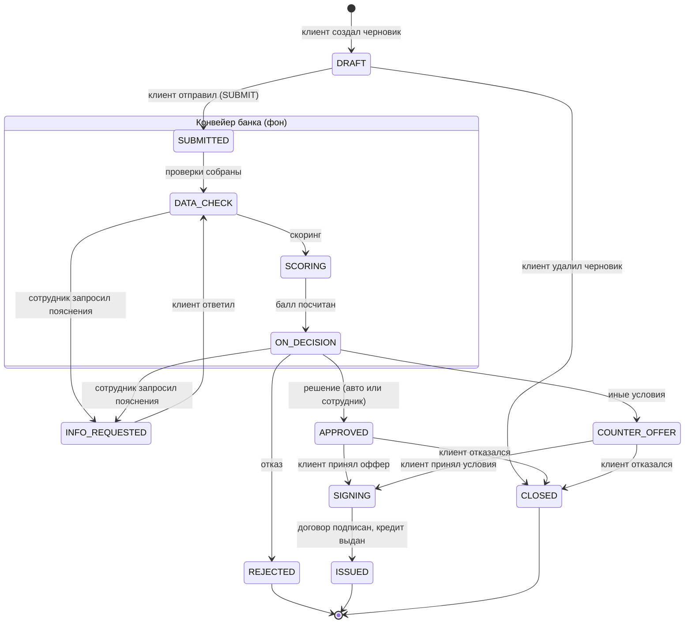

# Диаграмма состояний заявки

Статусы и переходы — ровно те, что разрешает машина состояний Origination
(`backend/internal/origination/machine.go`, таблица проверяется тестом `TestCanTransition` на всех парах статусов).
Подробности переходов, коды действий и правила — в [origination.md](origination.md#машина-состояний).

| Статус | Подпись | Чей ход |
|---|---|---|
| `DRAFT` | Черновик (в том числе этап 1 пройден или стоп-отказ этапа 1) | клиент |
| `SUBMITTED` | Подана | банк (конвейер) |
| `DATA_CHECK` | Проверка данных | банк |
| `INFO_REQUESTED` | Нужна доп. информация | клиент |
| `SCORING` | Обогащение и скоринг | банк (конвейер) |
| `ON_DECISION` | На решении | банк: авторешение или сотрудник |
| `APPROVED` / `COUNTER_OFFER` | Одобрено / Иные условия | клиент: принять или отказаться |
| `REJECTED` | Отказ | — (конечный) |
| `SIGNING` | Подписание | клиент: подпись и выдача |
| `ISSUED` | Выдано | — (конечный, дальше — обслуживание кредита) |
| `CLOSED` | Закрыта: черновик удалён или клиент отказался от оффера | — (конечный) |

Стоп-отказ этапа 1 — не статус, а результат предварительного решения внутри `DRAFT` (`prelim.outcome = STOP`):
заявку с ним нельзя отправить (`validate` / `submit`). Любой переход не из диаграммы — `409 INVALID_TRANSITION`.
